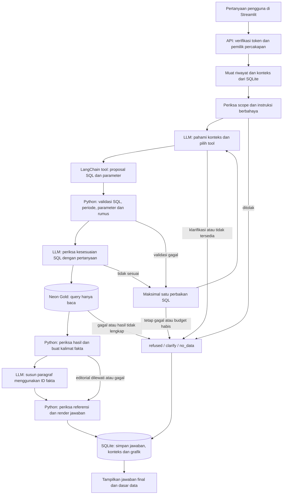

# Arsitektur Analytic Agent

Dokumen ini mengikuti implementasi saat ini dan ketentuan `required_files.participant.md`. Chatbot memakai Streamlit, FastAPI, LangChain ChatOpenAI, Neon Gold, dan SQLite untuk percakapan.

## Alur pertanyaan sampai jawaban

Diagram menunjukkan jalur analisis utama. Token tidak valid dihentikan dengan HTTP `401`; percakapan yang tidak ada atau bukan milik pengguna menghasilkan `404`, sebelum analisis dijalankan. Permintaan yang melewati batas antrean dapat mendapat `429`.

## Peran LLM dan Python

1. **Memahami pertanyaan.** `src/llm_client.py::select_tool()` mengirim pertanyaan, riwayat terbatas, konteks sebelumnya, periode dataset, tanggal saat ini, dan nilai dimensi tersedia. Model memilih tepat satu tool. Untuk analisis, model menyusun SQL PostgreSQL melalui `SQLQuery`, bukan memilih template kosakata per pertanyaan. Aturan sistem dan instruksi setiap tahap berada di `src/prompts.py`.
2. **Memeriksa query.** Python memvalidasi query terlebih dahulu. `LangChainClient.review()` kemudian meminta LLM menilai kecocokan metrik, periode, filter dan metode dengan pertanyaan. Review semantik ini dapat salah; keputusan model tidak melewati SQL guard.
3. **Menyusun paragraf.** Setelah query berhasil, Python membuat kalimat fakta lengkap. `LangChainClient.narrate()` hanya mengembalikan kelompok ID fakta melalui `NarrativeDraft`, tanpa teks faktual bebas. Model tidak menulis ulang angka atau menyimpulkan penyebab.
4. **Merender jawaban.** `src/answers.py::render_answer()` memastikan setiap fakta dipakai tepat sekali, tanpa referensi asing, dan mempertahankan urutan bucket periode. Fungsi ini menggabungkan kalimat fakta menjadi jawaban akhir. Metadata teknis disediakan terpisah melalui `data_basis`.

Alur normal dengan editorial memakai tiga panggilan model: proposal, review, dan penyusunan paragraf. Editorial dibatasi satu panggilan tanpa repair. Kegagalan editorial memakai jawaban deterministik dari fakta yang sama. Editorial dilewati untuk hasil lebih dari 20 fakta, lebih dari 12.000 karakter, atau hasil yang memuat kolom `exception_note`.

## Tool dan validasi SQL

`src/tools.py` menyediakan tiga LangChain `@tool`: `execute_gold_query`, `request_clarification`, dan `report_unavailable`. Aplikasi memeriksa jumlah call, nama tool, ID dan skema argumen sebelum `.invoke()`; tidak menjalankan tool paralel.

`src/query_engine.py` bersama `src/sql_guard.py` memeriksa:

- Satu SELECT dari satu tabel Gold yang diizinkan: `shipment_fact`, `carrier_daily`, atau `city_daily`. Jalur agent menolak join, CTE, subquery, UNION dan window untuk membatasi kesalahan grain.
- Allowlist tabel, kolom dan fungsi; operasi tulis, multi-statement serta schema lain ditolak menggunakan AST SQL.
- Parameter yang tepat sesuai placeholder. Aplikasi menambahkan filter tanggal cohort berdasarkan `start`, `end` dan `date_basis`; model tidak mengulang filter cohort di WHERE.
- Nama kolom hasil unik dan rumus alias metrik kanonis sesuai `src/metrics.py`. Rate harus menyertakan komponen pembilang/penyebut; hasil persentase diperiksa dan dihitung ulang oleh Python.
- Hasil tidak terpotong, tidak melewati batas ukuran, dan tidak memuat angka non-finite. LIMIT/OFFSET eksplisit serta periode sebagian dijelaskan pada jawaban.

Query yang gagal validasi atau review hanya mendapat maksimal satu kesempatan perbaikan total, dengan feedback. Budget dan deadline tetap berlaku, sehingga perbaikan tidak selalu dijalankan.

## Sumber data dan penyimpanan

**Neon Gold** adalah sumber fakta analitik pada konfigurasi produksi milestone. `src/gold.py` memakai sesi read-only, statement timeout, batas baris dan batas ukuran hasil. Role database juga harus memiliki izin hanya baca; validasi aplikasi bukan pengganti izin role. Kontrak dataset mencakup tanggal order 1 Juli–20 September 2026. Basis tanggal default adalah `order_date`/`metric_date`; permintaan berbasis delivery memakai `delivered_at_utc` dan dijelaskan pada jawaban.

**SQLite percakapan**, melalui `src/conversations.py`, menyimpan pemilik, pesan, outcome, dasar data, konteks SQL dan snapshot grafik. `src/api.py` membatasi operasi list/read/send/rename/delete berdasarkan identitas dari token. UI tidak menentukan `user_id`. Membuka ulang riwayat menampilkan snapshot tanpa mengulang query atau model; Compose menyimpan database ini pada named volume.

Backend **SQLite dari CSV sintetis** adalah pilihan terpisah untuk pengujian melalui `GOLD_BACKEND=sqlite`. Backend tersebut tidak menjadi fallback otomatis ketika Neon gagal. `LLM_ENABLED=false` menonaktifkan analisis dan menghasilkan `no_data`, tanpa parser template pengganti.

## Batas kepercayaan dan kegagalan

- Pesan pengguna, riwayat, nilai dimensi, serta `exception_note` adalah data tidak tepercaya. Instruksinya tidak memiliki hak mengubah aturan sistem, mengakses rahasia, atau menambah tool.
- `exception_note` tidak dikirim sebagai isi hasil tool ke model. Hasil yang memuat note melewati editorial; renderer memfilter instruksi berbahaya dan melakukan escaping saat menampilkan catatan sebagai data.
- `src/budget.py` membatasi percobaan tool/model/query, repair dan waktu per pesan. Percobaan gagal ikut dihitung; retry SDK model dinonaktifkan. Nilai konfigurasi berasal dari environment melalui `src/config.py`.
- Klarifikasi, penolakan, hasil kosong, model/database gagal, serta batas proses ditangani tanpa membuat angka pengganti. Kegagalan editorial tidak membuang hasil query yang sudah valid. Konteks analisis baru disimpan hanya untuk outcome `answered`.
- UI menerima jawaban dan metadata yang diperlukan, bukan SQL internal, kredensial atau raw chain-of-thought. `.env` dan SQLite percakapan tidak disalin ke image Docker.

Guard dan verifikasi angka tidak membuktikan seluruh makna pertanyaan, semua perhitungan nonkanonis, atau kualitas data sumber. Model masih dapat salah memahami. Autentikasi demo dan SQLite lokal juga belum merupakan rancangan multi-instance produksi.

Panduan menjalankan: [implementation.md](implementation.md). Bukti dan batas pengujian: [evaluation.md](evaluation.md). Urutan presentasi: [demo.md](demo.md).
